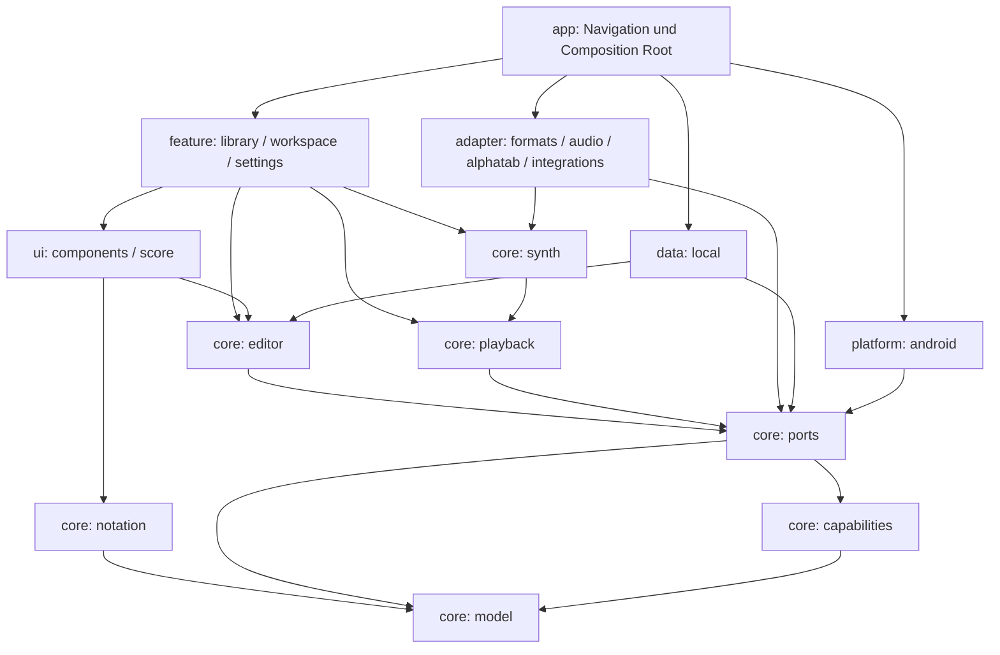

# Architektur und Zustandsflüsse

## Entscheidungen

Diese Entscheidungen wurden bei der Fertigstellung bewusst getroffen. Jede ist über einen Port umkehrbar, ohne das Musikmodell umzubauen.

1. **Native Android-App mit Kotlin/Compose, portabler Kern.** Modelle, Editor, Wiedergabe, Synthesizer und Notensatz sind gewöhnliche Kotlin/JVM-Module ohne Android-, Java- oder Drittanbieterimporte (von `verifyArchitecture` geprüft). Eine spätere Kotlin-Multiplatform-Umstellung braucht keine neuen musikalischen Schnittstellen.
2. **Eigener Notensatz statt alphaTab.** alphaTab 1.9.0 verlangt laut Release-Quellen SDK 37 und Kotlin-stdlib 2.4; das passt nicht zur gepinnten Toolchain. Außerdem müsste jede Bearbeitung über Bounds zurück auf eigene IDs übersetzt werden. `core:notation` setzt direkt aus dem Modell, erzeugt eine renderer-neutrale Anzeigeliste mit Trefferflächen und dient Bildschirm, SVG, PDF und Tests gleichermaßen. `adapter:alphatab` bleibt als erklärte UNAVAILABLE-Grenze bestehen.
3. **Eigener Synthesizer statt SoundFont/RSE.** E-Gitarren klingen aus einer eigenen Sample-Bank (CC0, Karoryfer Emilyguitar, RWSB-Format); für alles andere gibt es keine mitlieferbare Bank mit klaren Rechten. `core:synth` erzeugt Saiten physikalisch (erweitertes Karplus-Strong mit Bruchteil-Verzögerung), dadurch sind Bends, Vibrato, Palm-Mute, Dead Notes, Flageoletts, Legato und Saiten-Chokes pro Note möglich, ohne Kanal-Controller. Drums, Keys und Klick sind ebenfalls synthetisch; Amp, Cabinet und Effekte sind eigene DSP-Blöcke. Alles ist deterministisch und auf der JVM testbar. SF2-Import bleibt ein eigener Vertrag (C-SOUNDBANK).
4. **AudioTrack-Renderthread in Kotlin statt Oboe/NDK.** Float-PCM im Low-Latency-Modus mit nativer Rate/Burst und Hardware-Zeitstempeln. Damit läuft die komplette Engine samt Transport in JVM-Tests gegen eine virtuelle Senke. Falls Gerätemessungen es verlangen, ist ein Oboe-Adapter nur eine weitere `AudioSink`-Implementierung.
5. **Eigene Formatimplementierungen.** GP3/4/5, GPX, GP7/8 (GPIF), MIDI, MusicXML und ASCII-TAB werden selbst gelesen bzw. geschrieben, mit Inhaltserkennung, strikten Parsern, Ressourcenlimits und Verlustberichten. Originalbytes bleiben als Asset erhalten.
6. **Natives Schema bleibt Version 1.** Alle neuen Fähigkeiten nutzen bereits vorhandene typisierte Modellfelder. Neu sind nur Laufzeitklassen (Wiedergabeplan, Anzeigeliste), die nie gespeichert werden.
7. **Referenz-Audio über die Gerätedecoder.** MediaCodec deckt MP3, AAC/M4A, Ogg und FLAC ab, ohne Codecs mitzuliefern; WAV wird in Kotlin decodiert. Bis Time-Stretch existiert, ist Referenz-Audio nur bei 100 % Tempo hörbar statt falsch synchron.

## Module

Manuelle Dependency Injection lebt ausschließlich in `AppContainer`. Features kennen Repositories und Ports, nicht deren Dateisystem-, Geräte- oder Formatimplementierung. Testabhängigkeiten dürfen konkrete Adapter einsetzen. Der Fixture-Generator hat einen eigenen Source-Set und gelangt nicht in die APK.

## Projekt und Zeit

Project besitzt Metadaten, globale Measures, Tracks/Staffs/Bars/Voices/Beats/Notes, Tempo/Abschnitte, Layout, Text/Lyrics, Akkorde/Skalen, Audio, Mixgraph, Klangbankdefinitionen, Assets und Importherkunft. Jeder Staff referenziert dieselben globalen Takte in derselben Reihenfolge. Pro Bar stehen vier stabile Stimmen zur Verfügung. IDs sind unabhängig von Listenindizes.

- Fraction beschreibt exakte Bruchteile einer ganzen Note mit normalisierter positiver Basis und geprüfter Arithmetik. Eine punktierte Achtel ist 3/16; eine Achtel unter 3:2 und 5:4 ist 1/15.
- ScorePosition bezeichnet Takt und Offset. PlaybackOccurrence ergänzt Durchlauf und Routenindex. Eine Takt-ID allein ist für Wiederholungs-Playback unzureichend.
- Pixel und Samplepositionen sind abgeleitet. Floating Point wird nur für Anzeige und Audio verwendet; die Umrechnung Partitur → Frames ist eine stückweise Zeitabbildung pro Routenabschnitt.
- Note hält Tonhöhe sowie gegebenenfalls Saite/Bund. Tuning ist tief→hoch; Drop A ist MIDI 33/40/45/50/55/59/64. Neue Projekte (ProjectFactory.create) starten mit einem 4/4-Takt und einer 6-saitigen E-Standard-Gitarre 40/45/50/55/59/64; der Modell-Standardwert InstrumentDefinition() bleibt Drop A. Capo ist pro Saite gespeichert.
- Ties/Slurs/Legato referenzieren Zielnoten-IDs. Bends/Whammy halten rationale Kurvenpunkte in Cents. Bend ist niemals eine globale Kanaländerung.
- SyncMap verbindet konkrete Wiederholungsdurchläufe mit Audiozeit. Zeitgleiche Stems dürfen eine Map und eigene Offsets nutzen; verschiedene Aufnahmen dürfen getrennte Maps haben.

## Wiedergabe

`Project → UnfoldingRepeatCompiler → Timing → ScorePlaybackCompiler → PlaybackPlan → EngineProgram → SynthEngine → RealtimeHost → AudioSink`

- **Route:** Wiederholungen werden vollständig aufgelöst: `endCount` ist die Zahl der Durchläufe, Voltas gelten pro Durchlauf, D.C./D.S. springen einmal und spielen danach den letzten Durchlauf bis Fine bzw. ab „To Coda“ in die Coda. Jede Station kennt Takt, Durchlauf und Routenindex.
- **Zeit:** Tempo gilt in Schreibreihenfolge und wird auf jedem Durchlauf gleich angewandt. Swing verzerrt die Zeit innerhalb der Zählzeit, Fermaten verlängern lokal. Ergebnis sind `RouteSpan`-Zeitabbildungen (Offset ↔ Frame).
- **Noten:** Der Sequencer löst Artikulationen in Aufführungsdaten auf: Vorschläge, Staccato, Dynamik, Ghost/Akzent, Flageoletts über die Obertonreihe, Bends/Whammy/Slides als eigene Tonhöhenkurve pro Note, gebundene Noten verschmolzen, Hammer-on/Pull-off/Tapping/Slap/Pop als Anschlagsart, Let Ring, Tremolo und Triller expandiert. Pro Saite klingt höchstens eine Note (Saiten-Choke), Drums nutzen Choke-Gruppen.
- **Engine:** Der Plan ist unveränderlich, auf die Geräterate gerechnet und mit Geschwindigkeit skaliert. `EngineProgram` legt Ereignisse vorab in Arrays ab. `SynthEngine` rendert ohne Allokation, I/O oder Locks: Stimmenpools (72 Saiten, 48 Drums, 48 Keys), ein Kanal pro Spur mit Ton-Preset und Effektkette, Master-Limiter, Flush-to-Zero gegen Subnormalzahlen.
- **Host:** `RealtimeHost` besitzt den Renderthread mit Audio-Priorität. Befehle laufen über eine lock-freie Queue; neue Pläne werden blockgenau getauscht und behalten die musikalische Position. Seek rekonstruiert klingende Noten (Chase).
- **Uhr:** Die Position stammt aus den AudioTrack-Zeitstempeln (präsentierter Frame) und wird über den Plan in Takt, Offset und Durchlauf zurückgerechnet. Keine UI-Uhr treibt den Transport.
- **Offline:** `OfflineMixdown` nutzt denselben Compiler und dieselbe Engine für WAV-Mix und Stems; Stems teilen Startframe und Länge. Die Effektlatenz ist ausgeglichen (Planframe 0 = Dateiframe 0), die Stems sind unabhängig vom Master-Fader (Werkspegel) und summieren sich bei Werks-Master-Fader zum Mix ohne Master-Kette.

## Notensatz

`LayoutRequest → ScoreLayouter → ScoreLayout (Systeme, Takte, Spalten, Noten, Glyphen) → GlyphPainter / SvgExport / PdfExport`

Die Anzeigeliste besteht aus Linien, Rechtecken, Texten, Ovalen und Pfaden mit semantischer Farbe (Ink). Der Bildschirm zeichnet nur sichtbare Glyphen, SVG/PDF und der Java2D-Testrenderer zeichnen dieselbe Liste. Treffer werden über Spalten und Saitenlagen auf Takt, Offset und Saite zurückgeführt. TAB mit Rhythmus, Standardnotation mit Schlüsseln, Vorzeichen, Balken und Haltebögen sowie Drum-Notation entstehen aus demselben Layouter. 200 Takte mit je 16 Noten brauchen auf der JVM etwa 35 ms; das Layout läuft im ViewModel auf einem Hintergrund-Dispatcher.

## Formate

`Bytes → DefaultFormatCatalog.detect → ScoreImporter → ImportResult(Projekt, Verluste) → Library: Originalbytes als Asset + ImportProvenance → ScoreValidator → Repository`

Die Erkennung prüft Inhalte (ZIP-Einträge, Binärköpfe, XML-Wurzel), nicht die Dateiendung. XML wird ohne DTD/Entitäten gelesen, ZIP-Größen, Eintragszahlen und Verschachtelung sind begrenzt. Was ein Format nicht abbilden kann, steht als Verlusteintrag im Projekt und wird vor einem Export angezeigt.

## Referenz-Audio

Import: Dateiauswahl → `AudioDecoder.probe` (WAV in Kotlin, sonst MediaCodec) → AssetStore (SHA-256) → `AudioClip` im Projekt. Wiedergabe: `EngineTransport` lädt Clips über `DecodingClipLoader` (Asset → Decoder → `PcmBuilder`, der während des Decodierens auf die Geräterate resampelt; höchstens 10 Minuten) und übergibt ein `ClipSet`. Clips liegen in Planframes, deshalb bleiben sie bei Loop, Seek und Count-in sample-genau zur Partitur. Ein gemeinsames Solo gilt für Spuren und Clips.

## Zustandsfluss

`UI-Intent → EditorCommand → Kandidat/Validierung → immutable Revision → StateFlow/Layout/Transport → Autosave`

Die Autosave-Queue darf Zwischenrevisionen zusammenfassen, verliert jedoch nicht den neuesten Stand. Ein Mutex serialisiert Saves und flush. Bei Fehler bleibt die Musik im Speicher und der gespeicherte Revisionsstand unverändert; Retry nutzt genau diesen Stand. Vor dem Verlassen wartet die App auf flush. Beim Hintergrundwechsel pausiert die Wiedergabe und flush wird angestoßen. Ein sofortiger Prozessabbruch kann weiterhin noch nicht gespeicherte Änderungen verlieren; die Anzeige unterscheidet gespeichert, ausstehend und fehlgeschlagen.

Undo/Redo kopiert Musikstände, erhöht aber weiterhin die Revisionsnummer. Restore ist ein Replace-Command mit Ausgangsrevision. Asynchron geladene Snapshots dürfen spätere Änderungen nicht überschreiben. Die Historie ist linear und auf 200 Schritte begrenzt; benannte Snapshots sind dauerhaft.

Während der Wiedergabe kompiliert jede Änderung einen neuen Plan, der an derselben musikalischen Position übernommen wird. Ohne laufende Wiedergabe öffnet keine Änderung das Audiogerät.

## UI und Gesten

AppRoutes umfasst library, project/{projectId} und settings. Innerhalb einer Projektsitzung identifiziert WorkspacePage 14 Bereiche (inkl. Audio-Diagnose) mit stabilen Routen-IDs; Bereichswechsel erhalten dasselbe ViewModel. Mobil gibt es scrollbare Tabs, ab 840 dp eine NavigationRail. Ab 700 dp verfügbarem Editorplatz liegt das Eingabefeld seitlich.

Die Partitur ist eine Canvas über dem Layout: Pan, Pinch-Zoom um den Fokuspunkt, Tippen setzt den Cursor, Bereichsauswahl über Takte, mitlaufender Playhead. Ziffern bleiben Vorschau bis Commit und werden beim Eintragen angespielt. Akkordmodus hält die Position. Nummerneingabe, Quick-Bar, Griffbrett und Drumgrid gehen durch dieselben Commands; externe Tastaturen nutzen dieselben Befehle. Mixer- und Clip-Slider erzeugen erst am Ende einer Geste eine Transaktion.

Player, Decoder, View-Objekte und Content-URIs gelangen nie in das Musikmodell. Alle offenen Anbieter melden UNAVAILABLE mit Vertrags-ID. Die Funktionsansicht liest dasselbe Register wie die dokumentierte Paritätsmatrix.
