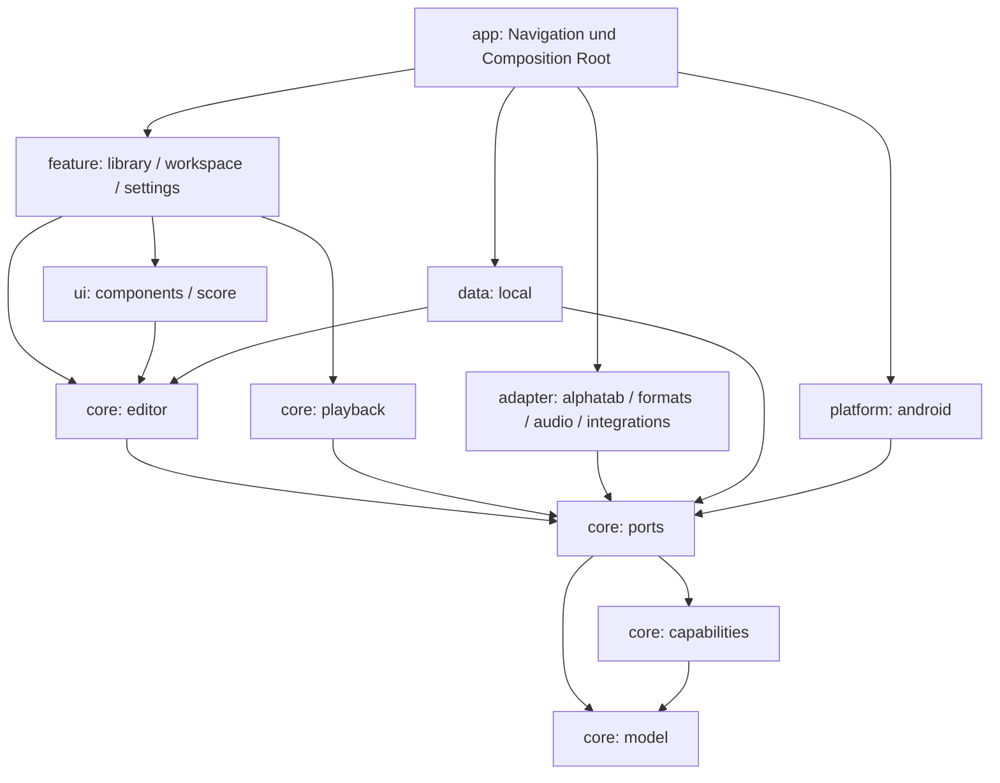

# Architektur und Zustandsflüsse

## Entscheidungen

Native Android-App mit Kotlin/Compose; Kernmodelle und Dienste sind gewöhnliche Kotlin/JVM-Module ohne Android-, Java- oder Drittanbieterimporte. Die zukünftige Umstellung dieser Module auf Kotlin Multiplatform benötigt keine Änderung der musikalischen Schnittstellen. Konkrete iOS-Targets und die iOS-Oberfläche sind nicht Teil von Phase 1.

Die eigene einfache TAB-Darstellung ist die erste nutzbare Ansicht. alphaTab bleibt hinter einem eigenen Adapter. TuxGuitar/fretwork dienen als Quellenreferenzen; es wurde kein Code oder Asset daraus übernommen. Eine unabhängige Audio-Engine ist nötig, weil alphaTab laut offizieller Dokumentation Synth oder Backing spielt und die geforderte gemeinsame Stem-Mischung dadurch nicht abgedeckt ist.

## Module

Manuelle Dependency Injection lebt ausschließlich in AppContainer. Features kennen Repositories und Ports, nicht deren Dateisystem- oder Bibliotheksimplementierung. Testabhängigkeiten dürfen konkrete Adapter einsetzen. Der Fixture-Generator hat einen eigenen Source-Set und gelangt nicht in die APK.

## Projekt und Zeit

Project besitzt Metadaten, globale Measures, Tracks/Staffs/Bars/Voices/Beats/Notes, Tempo/Abschnitte, Layout, Text/Lyrics, Akkorde/Skalen, Audio, Mixgraph, Klangbankdefinitionen, Assets und Importherkunft. Jeder Staff referenziert dieselben globalen Takte in derselben Reihenfolge. Pro Bar stehen vier stabile Stimmen zur Verfügung. IDs sind unabhängig von Listenindizes.

- Fraction beschreibt exakte Bruchteile einer ganzen Note mit normalisierter positiver Basis und geprüfter Arithmetik. Eine punktierte Achtel ist 3/16; eine Achtel unter 3:2 und 5:4 ist 1/15.
- ScorePosition bezeichnet Takt und Offset. PlaybackOccurrence ergänzt Durchlauf und Routenindex. Eine Takt-ID allein ist für Wiederholungs-Playback unzureichend.
- Pixel und Samplepositionen sind abgeleitet. Floating Point wird für Anzeige verwendet; Tempo-/Sample-Konvertierung hat einen eigenen Vertrag.
- Note hält Tonhöhe sowie gegebenenfalls Saite/Bund. Tuning ist tief→hoch; Drop A ist MIDI 33/40/45/50/55/59/64. Capo ist pro Saite gespeichert.
- Ties/Slurs/Legato referenzieren Zielnoten-IDs. Bends/Whammy halten rationale Kurvenpunkte in Cents. Vierteltöne bleiben darstellbar. Bend ist niemals eine globale Kanaländerung im Projektmodell.
- SyncMap verbindet konkrete Wiederholungsdurchläufe mit Audiozeit. Zeitgleiche Stems dürfen eine Map und eigene Offsets nutzen; verschiedene Aufnahmen dürfen getrennte Maps haben.

Das Modell speichert auch noch nicht bearbeitbare Eigenschaften. Das native Format bewahrt diese typisierten Werte; Serialisierung gilt nicht als hörbare oder GP-kompatible Implementierung.

## Zustandsfluss

`UI-Intent → EditorCommand → Kandidat/Validierung → immutable Revision → StateFlow/Rendering → Autosave`

Die Autosave-Queue darf Zwischenrevisionen zusammenfassen, verliert jedoch nicht den neuesten Stand. Ein Mutex serialisiert Saves und flush. Bei Fehler bleibt die Musik im Speicher und der gespeicherte Revisionsstand unverändert; Retry nutzt genau diesen Stand. Vor dem Verlassen wartet die App auf flush. Beim Hintergrundwechsel wird zusätzlich flush angestoßen. Ein sofortiger Prozessabbruch kann weiterhin noch nicht gespeicherte Änderungen verlieren; die Anzeige unterscheidet gespeichert, ausstehend und fehlgeschlagen.

Undo/Redo kopiert Musikstände, erhöht aber weiterhin die Revisionsnummer. Restore ist ein Replace-Command mit Ausgangsrevision. Asynchron geladene Snapshots dürfen spätere Änderungen nicht überschreiben. Aktuell ist die Historie linear und auf 200 Schritte begrenzt; benannte Snapshots sind dauerhaft. Verzweigte Historie ist ein eigener Ausbaupunkt.

## UI und Gesten

AppRoutes umfasst library, project/{projectId} und settings. Innerhalb einer Projektsitzung identifiziert WorkspacePage 13 Bereiche mit stabilen Routen-IDs; Bereichswechsel erhalten dasselbe ViewModel. Mobil gibt es scrollbare Tabs, ab 840 dp eine NavigationRail. Ab 700 dp verfügbarem Editorplatz liegt das Keypad seitlich. TAB virtualisiert Takte mit LazyRow; Saitenlabels bleiben daneben stehen.

Ziffern bleiben Vorschau bis Commit. Akkordmodus hält die Position. Nummerneingabe, Griffbrett und Drumgrid gehen durch dieselben Commands. Mixer-Slider erzeugen erst am Ende einer Geste eine Transaktion. Eine Gestenmaschine trennt Vorschau und Commit; die Touch-Anbindung fortgeschrittener Drags folgt in Etappe B.

Player, Decoder, View-Objekte und Content-URIs gelangen nie in das Musikmodell. Alle offenen Anbieter melden UNAVAILABLE mit Vertrags-ID. Die Funktionsansicht liest dasselbe Register wie die dokumentierte Paritätsmatrix.
